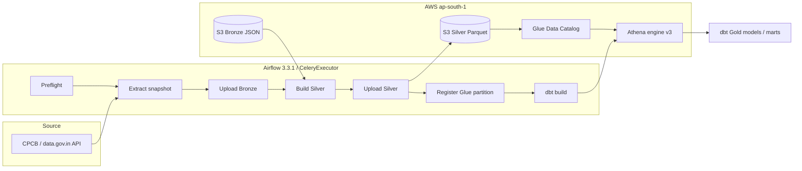

# Architecture — India Air Quality Data Lake

## Logical architecture

## Data layers

| Layer | Format | Responsibility |
|---|---|---|
| Bronze | Original JSON API pages | Immutable source evidence and extraction-level manifest |
| Silver | Snappy Parquet | Typed measurements, data-quality classifications, within-extraction deduplication, retrieval metadata |
| Catalog | Glue external table + partitions | Discover Silver schema and partition locations |
| Query | Athena | SQL access to the S3-backed Silver data |
| Transformation | dbt views/tables as configured | Staging, intermediate logic, facts, dimensions, marts and tests |

## Grain and keys

- Bronze grain: one source API page within one extraction.
- Silver grain: one extraction × source station candidate × pollutant × source timestamp record, after exact duplicate removal inside that extraction.
- Historical comparison grain: one candidate station-pollutant entity across the selected snapshots.
- `candidate_station_key` and `candidate_entity_key` are derived identifiers, not official CPCB station IDs.

## Failure boundaries

Each Airflow stage is a separate task boundary. Bronze is preserved before downstream transformations. Silver is written and verified before Glue registration. dbt is invoked only after the relevant Glue partition is registered. For recovery, inspect the failed task and verify its output before retrying only that task.

## Local orchestration boundary

The Airflow Docker Compose project lives under `airflow/` and is independent of the user's Airflow-Lab. It uses separate PostgreSQL and Redis services. Windows and Linux dbt artifacts must not share a partial-parsing cache; container dbt uses a Linux target path and `--no-partial-parse`.
